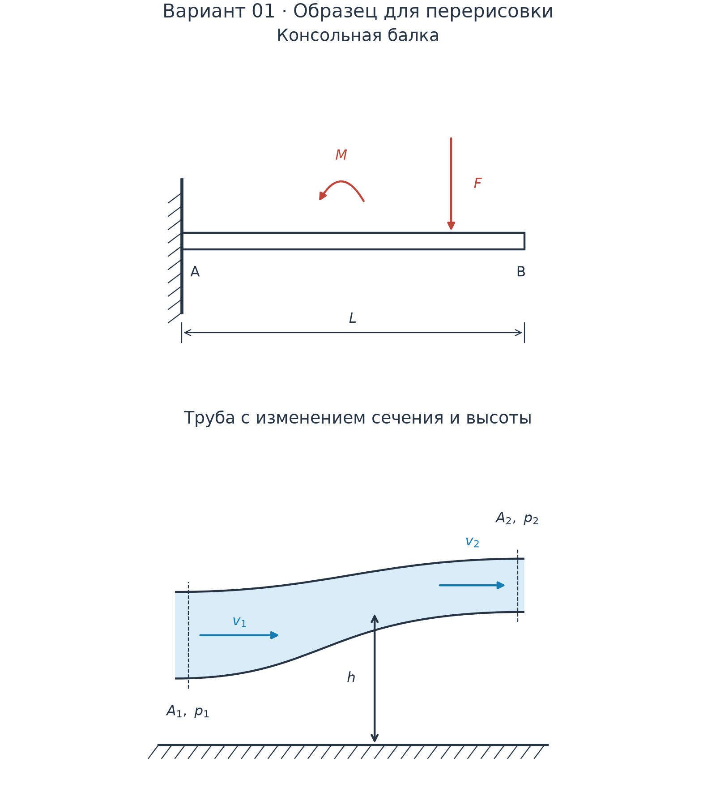

# Вариант 01

## Термех — Консольная балка

Сохраните элементы: Балка, заделка со штриховкой, сила F, момент M, точки A/B, размер L.

## Гидромеханика — Труба с изменением сечения и высоты

Сохраните элементы: Две плавные стенки, сечения A₁/A₂, стрелки v₁/v₂, давления p₁/p₂, высота h.

Геометрия условная. Повторите связи между элементами и направления стрелок; попиксельное совпадение не требуется. Буквенные обозначения можно набрать латиницей, индексы должны оставаться индексами. Для φ в варианте 4 показана условная дуговая стрелка поворота, а не дополнительный силовой момент.

Обязательные операции, структура документа и сдача описаны в [общем задании](../README.md).
