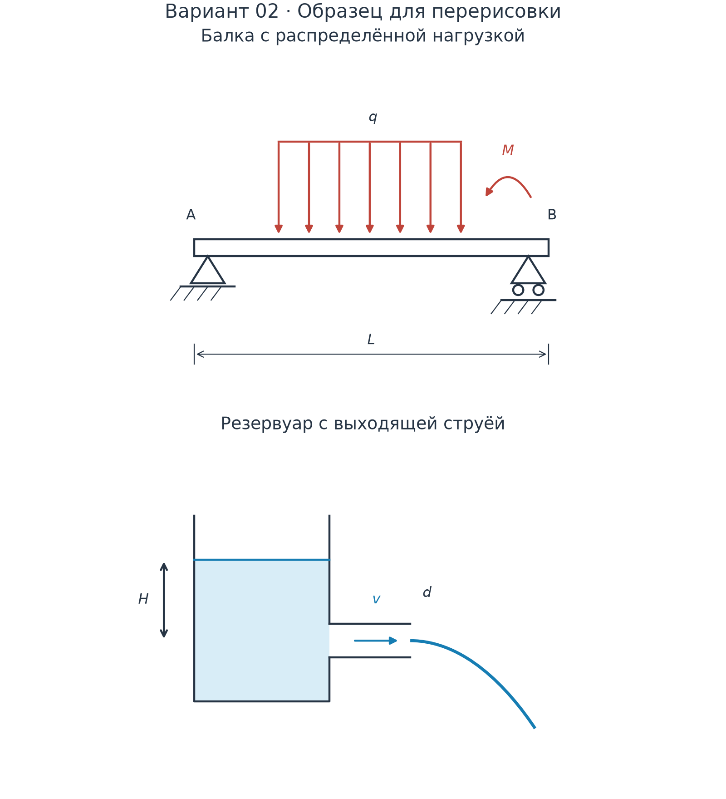

# Вариант 02

## Термех — Балка с распределённой нагрузкой

Сохраните элементы: Две опоры, ряд одинаковых стрелок q, момент M и размер L.

## Гидромеханика — Резервуар с выходящей струёй

Сохраните элементы: Открытый сосуд, уровень воды, отверстие, изогнутая струя, v, H и d.

Геометрия условная. Повторите связи между элементами и направления стрелок; попиксельное совпадение не требуется. Буквенные обозначения можно набрать латиницей, индексы должны оставаться индексами. Для φ в варианте 4 показана условная дуговая стрелка поворота, а не дополнительный силовой момент.

Обязательные операции, структура документа и сдача описаны в [общем задании](../README.md).
