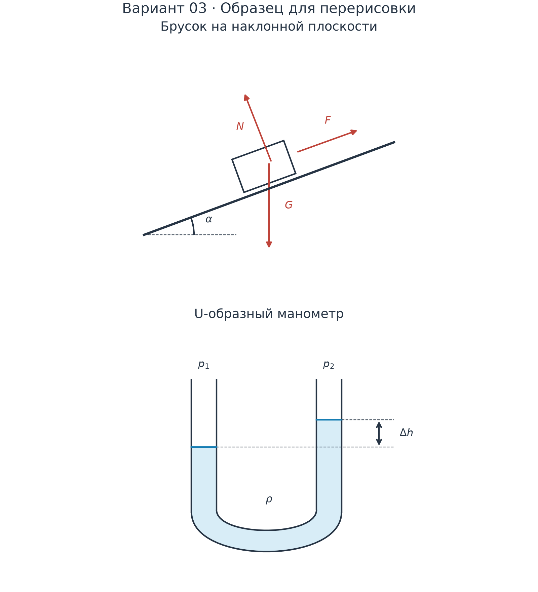

# Вариант 03

## Термех — Брусок на наклонной плоскости

Сохраните элементы: Наклонная плоскость, повёрнутый брусок, три стрелки G/N/F, дуга угла α.

## Гидромеханика — U-образный манометр

Сохраните элементы: Две стенки изогнутой трубки, заливка, разные уровни, p₁/p₂, ρ, размер Δh.

Геометрия условная. Повторите связи между элементами и направления стрелок; попиксельное совпадение не требуется. Буквенные обозначения можно набрать латиницей, индексы должны оставаться индексами. Для φ в варианте 4 показана условная дуговая стрелка поворота, а не дополнительный силовой момент.

Обязательные операции, структура документа и сдача описаны в [общем задании](../README.md).
