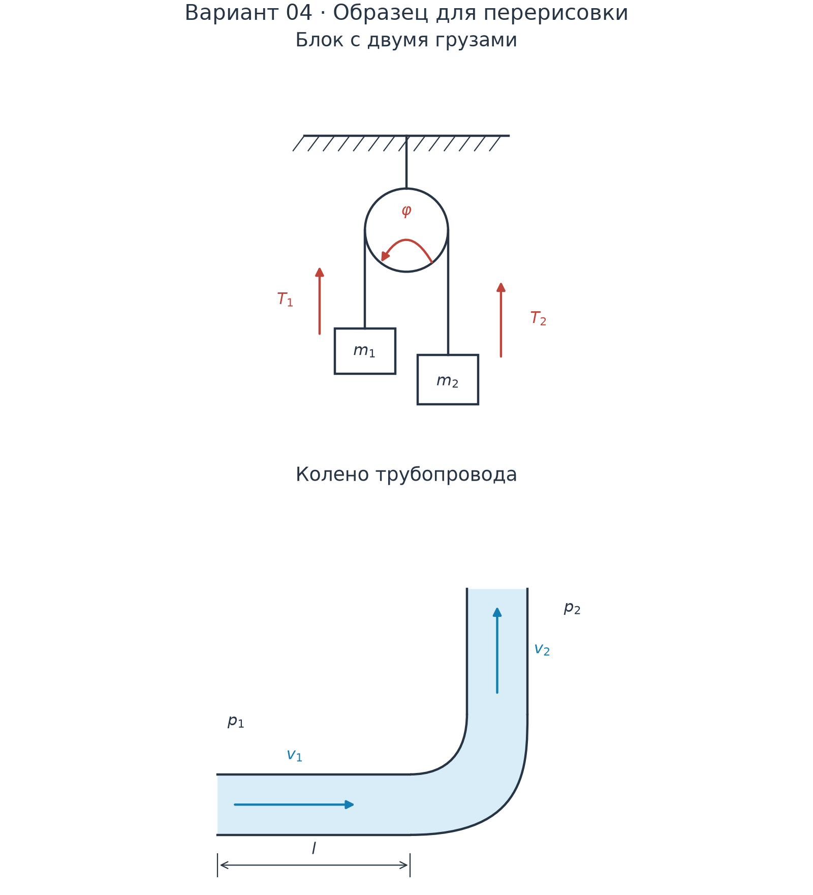

# Вариант 04

## Термех — Блок с двумя грузами

Сохраните элементы: Колесо блока, две ветви нити, грузы m₁/m₂, стрелки T₁/T₂, дуговая стрелка φ.

## Гидромеханика — Колено трубопровода

Сохраните элементы: Поворот трубы на 90°, плавные стенки, стрелки v₁/v₂, p₁/p₂ и размер l.

Геометрия условная. Повторите связи между элементами и направления стрелок; попиксельное совпадение не требуется. Буквенные обозначения можно набрать латиницей, индексы должны оставаться индексами. Для φ в варианте 4 показана условная дуговая стрелка поворота, а не дополнительный силовой момент.

Обязательные операции, структура документа и сдача описаны в [общем задании](../README.md).
