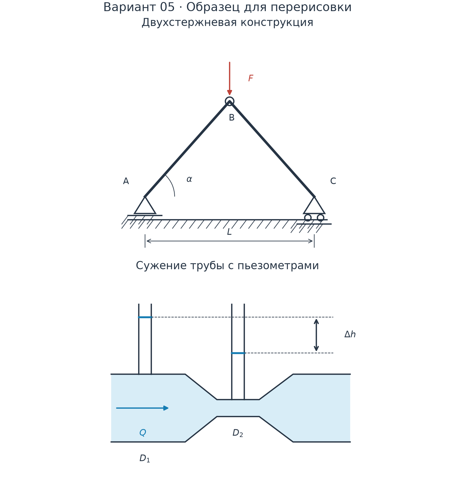

# Вариант 05

## Термех — Двухстержневая конструкция

Сохраните элементы: Два наклонных стержня, шарнир, две опоры, сила F, точки A/B/C, L и α.

## Гидромеханика — Сужение трубы с пьезометрами

Сохраните элементы: Сужение с расширением, две вертикальные трубки, уровни, Q, D₁/D₂ и Δh.

Геометрия условная. Повторите связи между элементами и направления стрелок; попиксельное совпадение не требуется. Буквенные обозначения можно набрать латиницей, индексы должны оставаться индексами. Для φ в варианте 4 показана условная дуговая стрелка поворота, а не дополнительный силовой момент.

Обязательные операции, структура документа и сдача описаны в [общем задании](../README.md).
