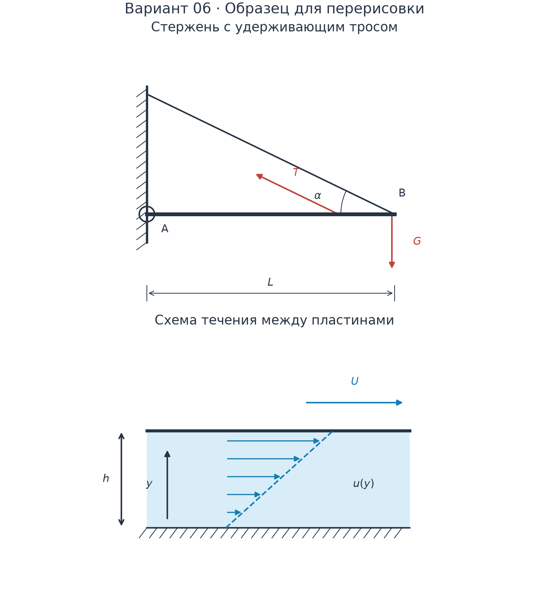

# Вариант 06

## Термех — Стержень с удерживающим тросом

Сохраните элементы: Стена, стержень, наклонный трос, шарнир, стрелки T/G, L и угол α.

## Гидромеханика — Схема течения между пластинами

Сохраните элементы: Две пластины, заливка зазора, U, ряд стрелок u(y) разной длины, h и ось y.

Геометрия условная. Повторите связи между элементами и направления стрелок; попиксельное совпадение не требуется. Буквенные обозначения можно набрать латиницей, индексы должны оставаться индексами. Для φ в варианте 4 показана условная дуговая стрелка поворота, а не дополнительный силовой момент.

Обязательные операции, структура документа и сдача описаны в [общем задании](../README.md).
