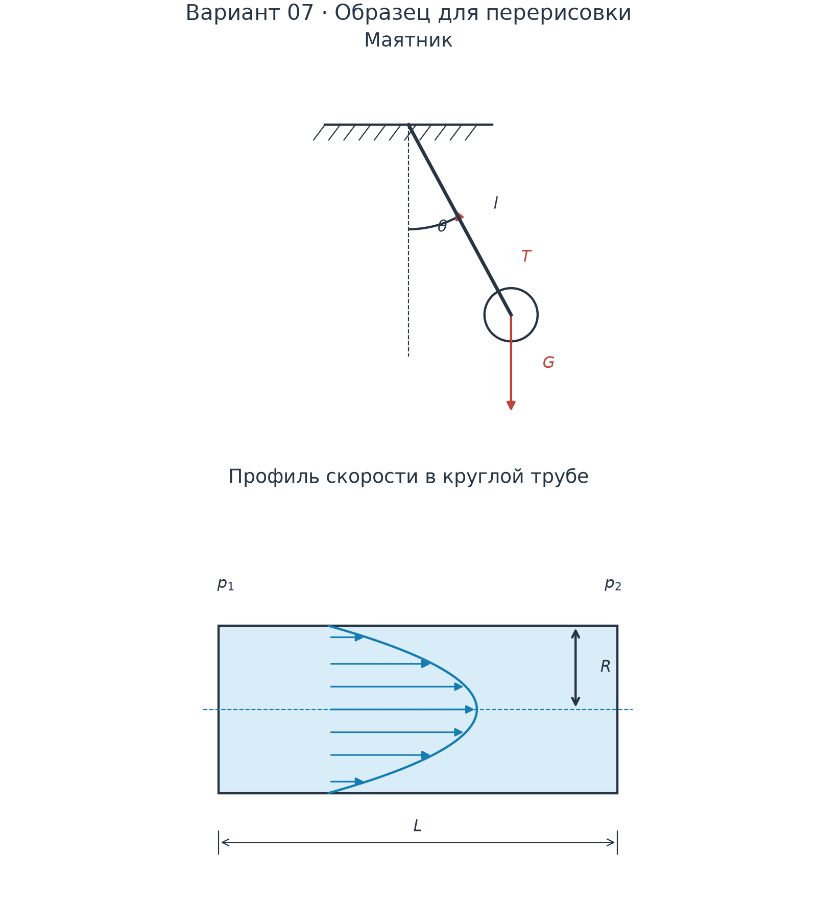

# Вариант 07

## Термех — Маятник

Сохраните элементы: Подвес, наклонная нить, груз, вертикальный пунктир, дуга θ, l, G/T.

## Гидромеханика — Профиль скорости в круглой трубе

Сохраните элементы: Продольный разрез трубы, осевой пунктир, профиль скорости, ряд стрелок, p₁/p₂, R/L.

Геометрия условная. Повторите связи между элементами и направления стрелок; попиксельное совпадение не требуется. Буквенные обозначения можно набрать латиницей, индексы должны оставаться индексами. Для φ в варианте 4 показана условная дуговая стрелка поворота, а не дополнительный силовой момент.

Обязательные операции, структура документа и сдача описаны в [общем задании](../README.md).
