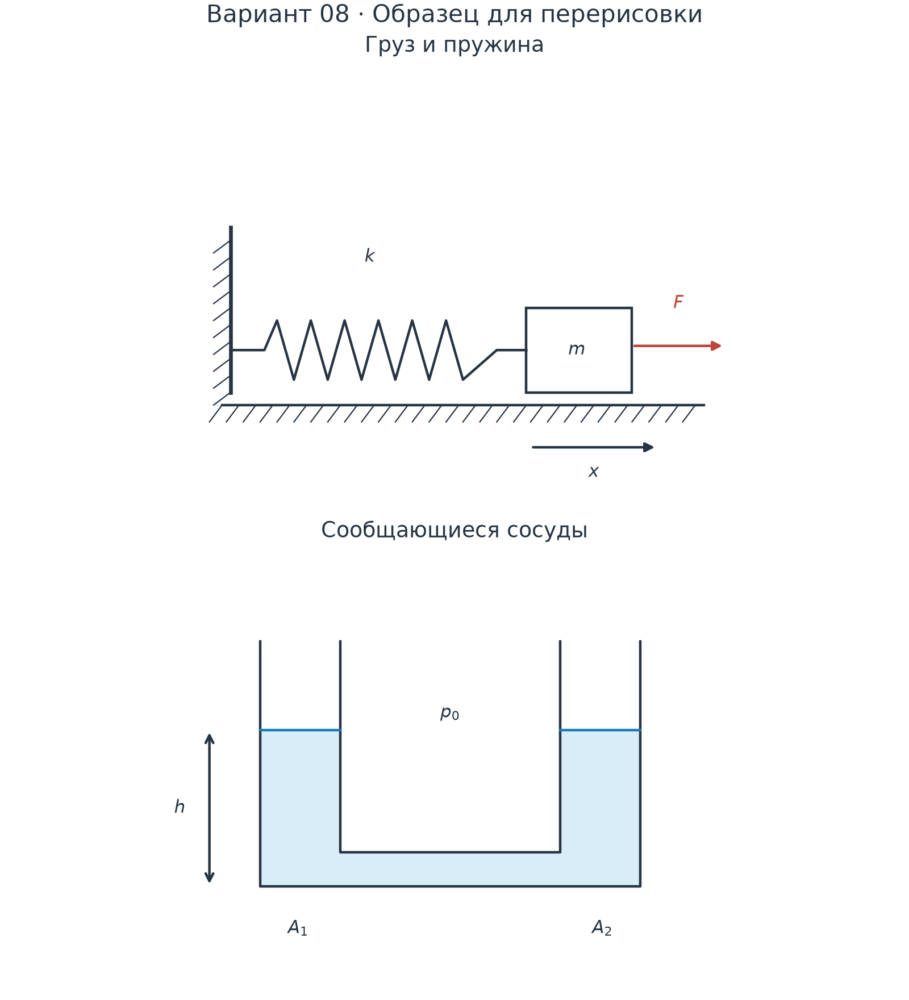

# Вариант 08

## Термех — Груз и пружина

Сохраните элементы: Стена, зигзагообразная пружина, груз, направляющая, k/m, F и ось x.

## Гидромеханика — Сообщающиеся сосуды

Сохраните элементы: Два открытых сосуда разной ширины с перемычкой, заливка, уровни, p₀, A₁/A₂ и h.

Геометрия условная. Повторите связи между элементами и направления стрелок; попиксельное совпадение не требуется. Буквенные обозначения можно набрать латиницей, индексы должны оставаться индексами. Для φ в варианте 4 показана условная дуговая стрелка поворота, а не дополнительный силовой момент.

Обязательные операции, структура документа и сдача описаны в [общем задании](../README.md).
