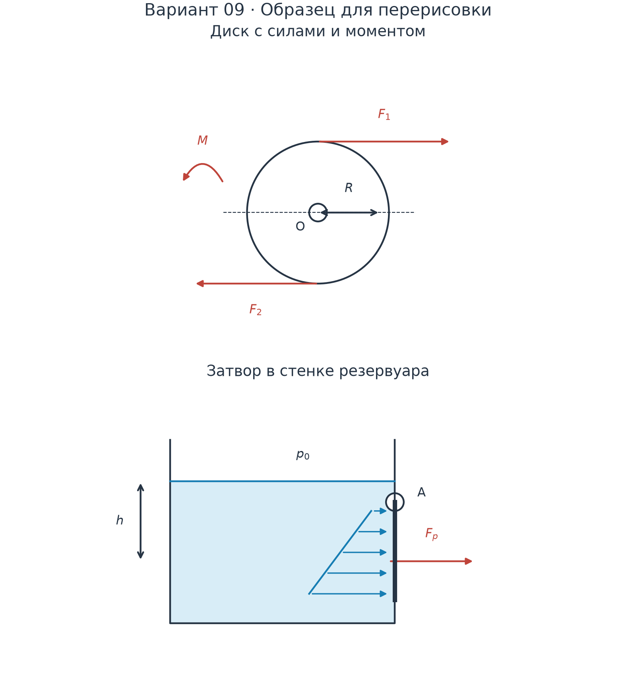

# Вариант 09

## Термех — Диск с силами и моментом

Сохраните элементы: Диск, центр O, две касательные силы F₁/F₂, момент M, ось и размер R.

## Гидромеханика — Затвор в стенке резервуара

Сохраните элементы: Сосуд, вода, выделенный затвор с шарниром A, ряд стрелок давления, Fₚ, p₀ и h.

Геометрия условная. Повторите связи между элементами и направления стрелок; попиксельное совпадение не требуется. Буквенные обозначения можно набрать латиницей, индексы должны оставаться индексами. Для φ в варианте 4 показана условная дуговая стрелка поворота, а не дополнительный силовой момент.

Обязательные операции, структура документа и сдача описаны в [общем задании](../README.md).
