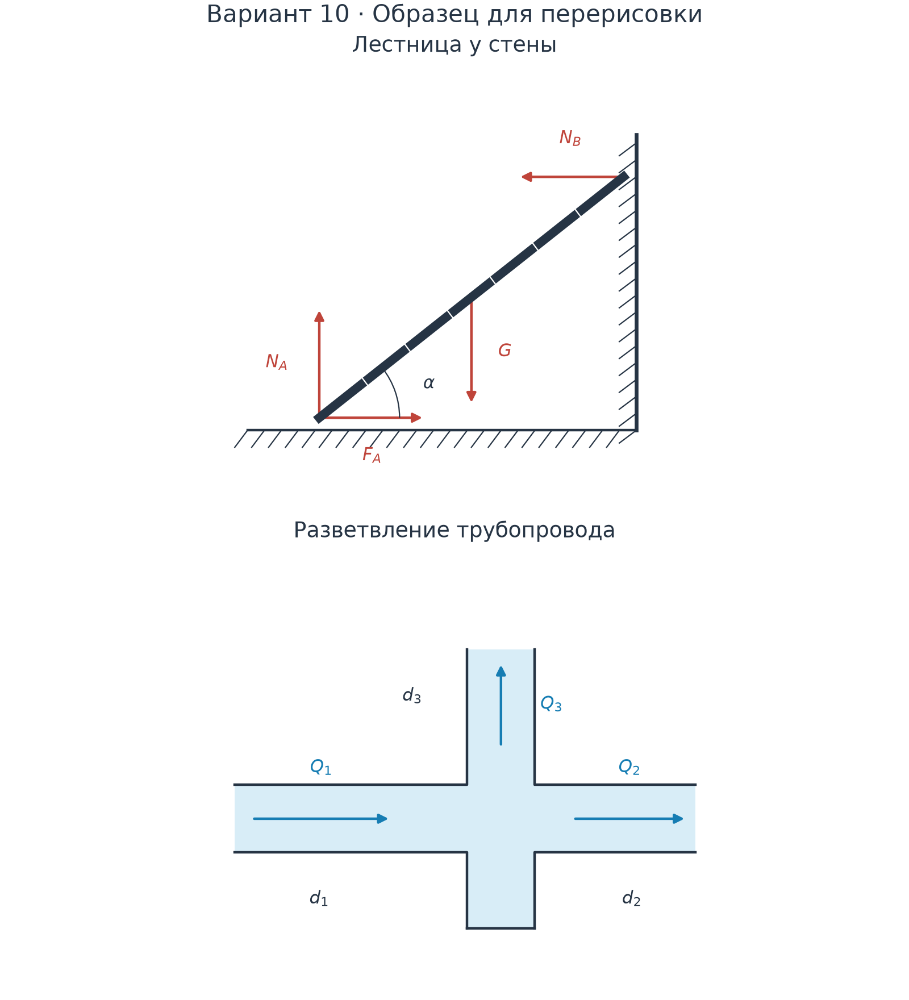

# Вариант 10

## Термех — Лестница у стены

Сохраните элементы: Пол, стена, наклонная лестница с перекладинами, G/N_A/N_B/F_A и угол α.

## Гидромеханика — Разветвление трубопровода

Сохраните элементы: Т-образная труба, заливка, три направления потока Q₁/Q₂/Q₃ и диаметры d₁/d₂/d₃.

Геометрия условная. Повторите связи между элементами и направления стрелок; попиксельное совпадение не требуется. Буквенные обозначения можно набрать латиницей, индексы должны оставаться индексами. Для φ в варианте 4 показана условная дуговая стрелка поворота, а не дополнительный силовой момент.

Обязательные операции, структура документа и сдача описаны в [общем задании](../README.md).
