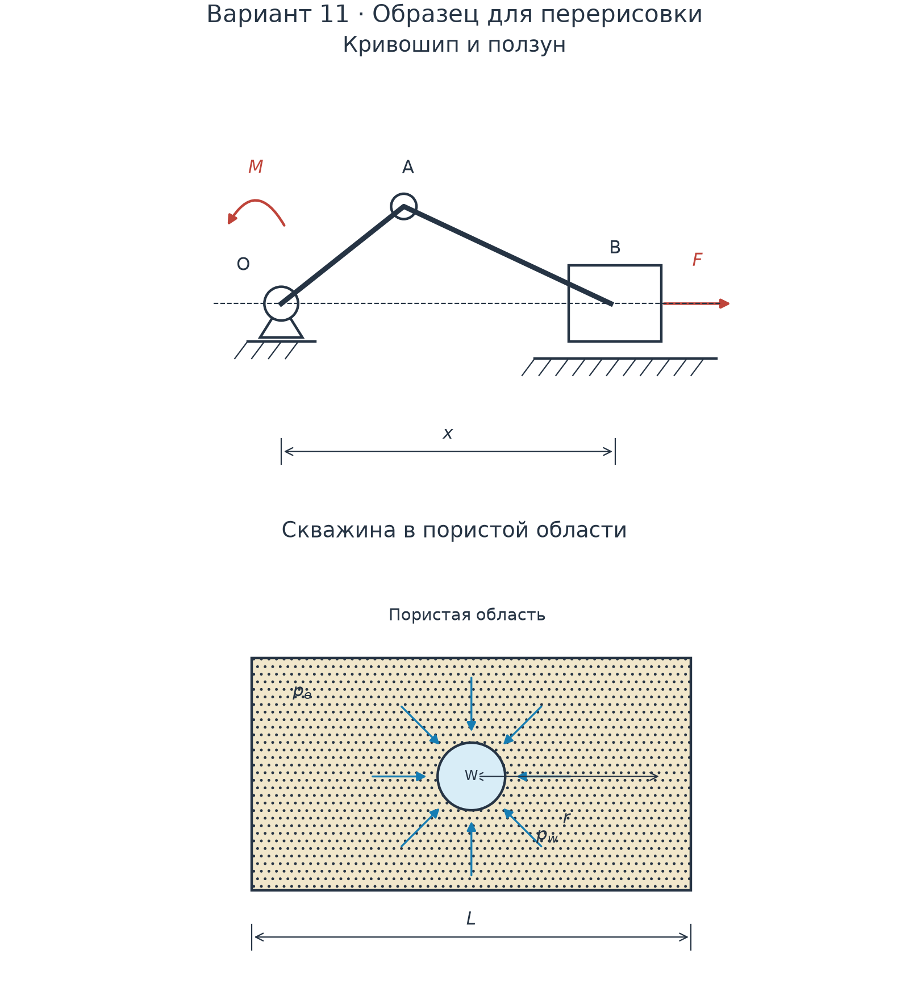

# Вариант 11

## Термех — Кривошип и ползун

Сохраните элементы: Два стержня, шарниры O/A, ползун B, направляющая, момент M, сила F и размер x.

## Гидромеханика — Скважина в пористой области

Сохраните элементы: Прямоугольная область с узором, скважина W, радиальные стрелки, pₑ/p_w, размеры r/L.

Геометрия условная. Повторите связи между элементами и направления стрелок; попиксельное совпадение не требуется. Буквенные обозначения можно набрать латиницей, индексы должны оставаться индексами. Для φ в варианте 4 показана условная дуговая стрелка поворота, а не дополнительный силовой момент.

Обязательные операции, структура документа и сдача описаны в [общем задании](../README.md).
